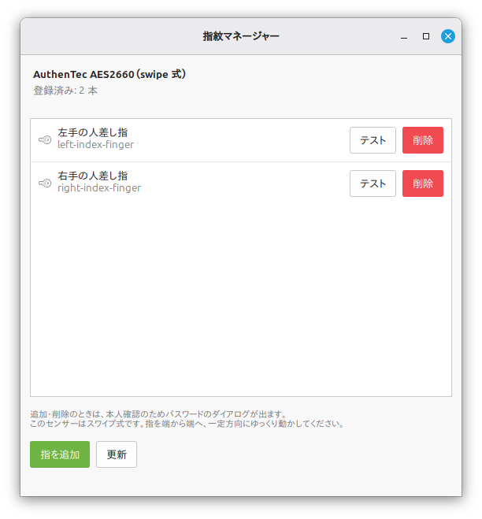

# 指紋マネージャー (Cinnamon Fingerprint Manager)

[](https://github.com/kazpc1215/cinnamon-fingerprint-manager/actions/workflows/ci.yml)

Linux Mint / Cinnamon には指紋認証の設定 GUI がありません。このアプリは、`fprintd` による指紋の**登録・照合テスト・削除**をデスクトップから行えるようにする小さな GTK3 フロントエンドです。

追加のランタイム依存はなく、Linux Mint に標準で入っている Python 3 + GTK3 + fprintd だけで動作します。



## 機能

- 登録済みの指紋を一覧表示（デバイス名・スキャン方式も表示）
- 指を選んで登録（`fprintd-enroll`）
- 登録した指で照合テスト（`fprintd-verify`）
- 指ごとに削除（`fprintd-delete`）
- 実行中の処理を中止
- コマンドの出力（`enroll-completed` / `verify-match` など）をそのまま表示

## 動作確認環境

| 項目 | 内容 |
|---|---|
| OS | Linux Mint 22.3 (Zena) / Cinnamon |
| デスクトップ | Cinnamon (GTK3) |
| fprintd | 1.94.3 |
| libfprint | 1:1.94.7 |
| センサー | AuthenTec AES2660 (`08ff:2683`, スワイプ式) |

`fprintd` が扱えるセンサーであれば、スワイプ式・静電容量式を問わず利用できます。GTK3 が動く環境なら Cinnamon 以外（MATE / XFCE など）でも動作するはずです。

## 必要パッケージ

```bash
sudo apt install fprintd libpam-fprintd python3-gi gir1.2-gtk-3.0
```

Linux Mint ではこれらは導入済みのことが多いです。

## インストール

```bash
git clone https://github.com/kazpc1215/cinnamon-fingerprint-manager.git
cd cinnamon-fingerprint-manager
./install.sh
```

`install.sh` は以下を行います。

- `~/.local/share/fingerprint-manager/cinnamon_fingerprint_manager/` にパッケージを配置
- `~/.local/share/applications/fingerprint-manager.desktop` を作成（アプリメニューに登録）

実行時はシステムの Python 3 と PyGObject を使います（uv や仮想環境は不要です）。

デスクトップにもアイコンを置く場合:

```bash
./install.sh --desktop
```

アンインストール:

```bash
./uninstall.sh
```

### pip / venv でインストールする場合の注意

`pip install .` で Python パッケージ自体はインストールできますが、次の点に注意してください。

- PyGObject (`gi`) と GTK3 はシステムパッケージ（`python3-gi` / `gir1.2-gtk-3.0`）であり、pip の依存関係には含まれません
- 通常の venv や `pipx` / `uv tool install` ではシステムの `gi` を参照できず、起動時に「GTK3 / PyGObject を読み込めませんでした」と表示されます
- `fprintd` 本体も pip ではインストールされません

そのため、通常は `./install.sh` を使ってください。どうしても pip を使う場合は、システム Python の環境に入れるか、`python3 -m venv --system-site-packages` で作成した venv を使ってください。

## 使い方

アプリメニューで「指紋」と検索するか、ターミナルから起動します。

```bash
gtk-launch fingerprint-manager
```

1. **指を追加** → 登録する指を選択 → パスワード確認 → センサーをスワイプ
2. **テスト** → その指でスワイプし、`verify-match` になるか確認
3. **削除** → 確認 → パスワード確認 → 登録を削除

登録・削除時にパスワードを求められるのは、`fprintd` の polkit ポリシー（`net.reactivated.fprint.device.enroll` = `auth_self_keep`）による仕様です。照合テストは認証不要です。

### スワイプ式センサーのコツ

- 1 回ごとに指を離し、端から端へ一定方向に動かす
- 速すぎる／遅すぎるスワイプは失敗しやすい
- 乾燥しているときは、少し息を吹きかけると通りやすい
- 利き手・逆手の 2 本を登録しておくと安定する

## 認証（PAM）を有効にする

指紋をログイン・sudo・画面ロック解除で使うには、PAM への組み込みが必要です。

```bash
sudo pam-auth-update --enable fprintd
```

無効化する場合:

```bash
sudo pam-auth-update --disable fprintd
```

指紋が失敗した場合は、`pam_fprintd` の設定（`default=ignore`）により通常のパスワード入力にフォールバックします。

## 仕組み

`fprintd` の CLI（`fprintd-list` / `fprintd-enroll` / `fprintd-verify` / `fprintd-delete`）を `subprocess` で呼び出し、出力を非同期に画面へ流しているだけです。独自のドライバや D-Bus 実装は持たず、`fprintd` の状態をそのまま反映します。

コードは 2 つに分かれています。

- `src/cinnamon_fingerprint_manager/core.py` — 出力の解析・コマンド組み立て・結果判定（GTK 非依存でテスト可能）
- `src/cinnamon_fingerprint_manager/gui.py` — GTK3 の画面

## 既知の制限

- 複数の指紋デバイスがある場合、`fprintd-list` が返す最初の 1 台のみを表示します
- デバイス名や指の内部名は `fprintd` の出力（英語）を基にしています
- 登録・削除には polkit エージェント（Cinnamon 標準のもの）が必要です

## 開発

パッケージ管理・lint・テストには [uv](https://docs.astral.sh/uv/) を使います（実行時には不要）。

```bash
uv sync                  # 開発用の仮想環境と依存を用意
uv run ruff check .      # lint
uv run ruff format .     # format（確認のみなら --check）
uv run pytest -q         # 単体テスト
```

GUI はシステムの PyGObject を使うため、リポジトリから直接起動する場合はシステム Python で実行します。

```bash
PYTHONPATH=src python3 -m cinnamon_fingerprint_manager
```

画面を実際に組み立てて描画するスモークテストは、Xvfb 上で実行できます。

```bash
xvfb-run -a env PYTHONPATH=src python3 tests/gui_smoke.py
```

CI（GitHub Actions）は **lint / test / GTK UI smoke** の 3 ジョブに分かれています。GTK UI smoke では Xvfb 上でウィンドウを生成し、ウィジェットの描画まで確認します。

## ライセンス

[MIT](LICENSE)

---

A small GTK3 GUI for managing fingerprints with `fprintd` on Linux Mint / Cinnamon: enroll, verify and delete enrolled fingers. No extra runtime dependencies beyond Python 3, GTK3 and fprintd.
